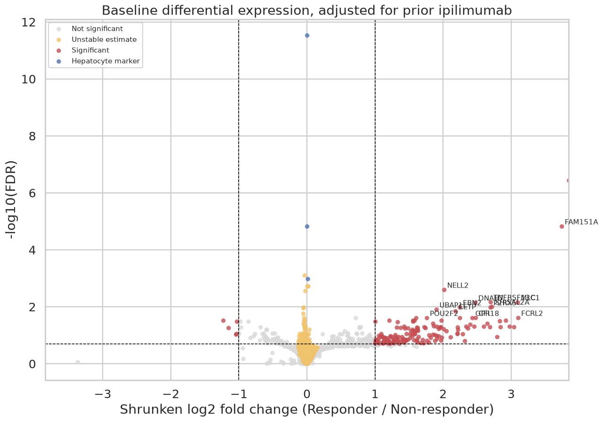
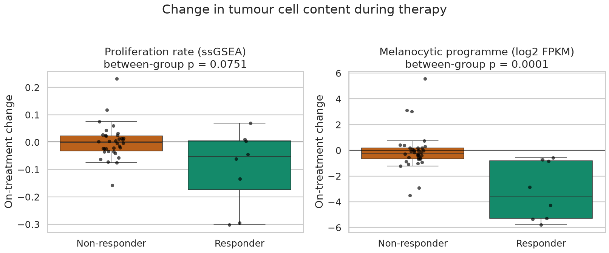
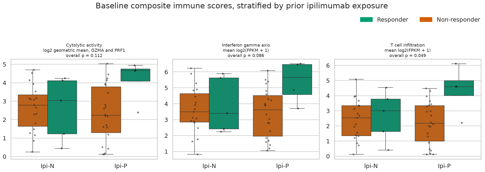
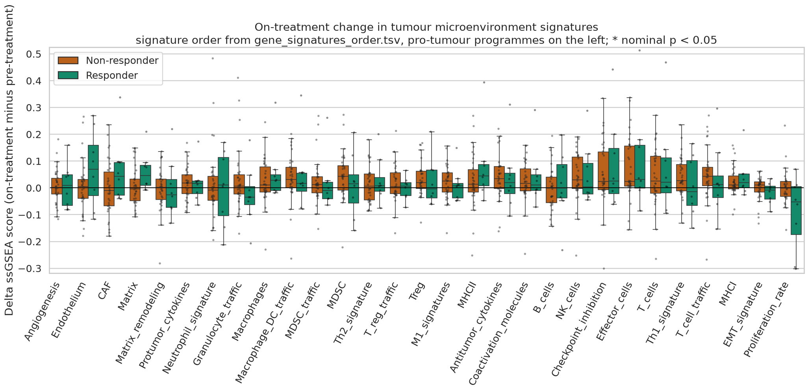

<div align="center">

# Transcriptomic determinants of response to nivolumab in melanoma

**Reanalysis of pre- and on-treatment tumour RNA-seq from the CheckMate-038 cohort (GEO [GSE91061](https://www.ncbi.nlm.nih.gov/geo/query/acc.cgi?acc=GSE91061))**


[**Notebook**](notebooks/nivolumab_response_analysis.ipynb) · [**HTML report**](docs/index.html) · [**Figures**](figures/)

</div>

---

## Overview

Immune checkpoint blockade with anti-PD-1 antibodies produces durable responses in only a
minority of patients with advanced melanoma. This project reanalyses bulk RNA-seq data from
[Riaz et al., *Cell* 2017](https://doi.org/10.1016/j.cell.2017.09.028) — 109 tumour biopsies
from 65 patients sampled **before** and **four weeks into** nivolumab therapy — to answer three
questions:

| # | Question | Data |
|---|---|---|
| 1 | Which **baseline** transcriptional features are associated with response? | Pre-treatment biopsies (n = 50) |
| 2 | How does the **tumour microenvironment (TME) change** during therapy, and does it differ by response? | Matched pre/on pairs (n = 42 patients) |
| 3 | What **limits** the interpretation, and which strategies could help **non-responders**? | Synthesis |

Patients are split by best overall response (RECIST v1.1): **responders** = CR/PR,
**non-responders** = SD/PD/NE.

## Key findings

1. **No single baseline gene is a robust predictor.** In a naive genome-wide screen, the
   strongest signals are hepatocyte transcripts from two liver metastases (unshrunken
   log2FC up to ~32). After detection filtering and fold-change shrinkage, **171 reliable
   genes** remain (FDR < 0.20, |log2FC| ≥ 1), 166 of them higher in responders.
2. **A B-cell / tertiary-lymphoid-structure module** (TNFRSF13C, CD79A, SPIB, FCRL2, POU2F2,
   BACH2) is among the most reproducible baseline signals — consistent with later work linking
   intratumoral B cells and TLS to checkpoint-blockade response.
3. **Composite immune scores separate the groups only in ipilimumab-progressed patients.**
   Cytolytic activity, the IFN-γ axis and T-cell infiltration are higher in responders and
   reach nominal significance in the Ipi-P stratum only — a pre-existing "hot" TME is required
   for response after anti-CTLA-4 failure.
4. **Pathway level is coherent:** GSEA recovers IFN-γ response, allograft rejection,
   IL6-JAK-STAT3, PD-1 and TCR signalling as enriched in responders.
5. **On therapy, the dominant change in responders is loss of tumour cells**, captured by a
   melanocytic differentiation programme (between-group p = 0.0001) and a proliferation
   signature.
6. **Counter-intuitively, several immune signatures rise significantly in non-responders**
   (effector cells, checkpoints, antigen presentation, Treg). Two explanations are quantified:
   a ceiling effect with limited power (n = 8 paired responders), and the compositional nature
   of ssGSEA scores.

<table>
<tr>
<td width="50%"></td>
<td width="50%"></td>
</tr>
<tr>
<td align="center"><sub>Baseline DE (DESeq2, adjusted for prior ipilimumab) with unstable estimates and hepatocyte markers flagged</sub></td>
<td align="center"><sub>Responders lose tumour cell content during therapy</sub></td>
</tr>
</table>

<p align="center">
  
  <br><sub>Baseline composite immune scores, stratified by prior ipilimumab exposure</sub>
</p>

<p align="center">
  
  <br><sub>On-treatment change in 29 TME signatures (ssGSEA), responders vs non-responders</sub>
</p>

## Methodological safeguards

Small cohorts make RNA-seq comparisons fragile. The analysis builds in explicit checks
rather than reporting raw hit lists:

- **Tissue composition before DE.** A hepatocyte marker score flags liver-contaminated
  biopsies so that hepatic RNA is not mistaken for immunotherapy biology.
- **Fold-change shrinkage + stability flag.** Genes whose effect collapses under
  empirical-Bayes shrinkage (< 20 % of the raw estimate retained) are excluded from
  interpretation, since PyDESeq2 does not recompute p-values after shrinkage.
- **Correct ID aggregation.** Entrez → HGNC mapping sums additive quantities (counts, FPKM)
  but keeps the most expressed identifier for log-scale values.
- **Pipeline validation.** The recomputed cytolytic score correlates with the published one
  at Spearman ρ = 0.992.
- **Paired design and composition adjustment.** On-treatment changes are tested within
  patient (Wilcoxon signed-rank) and adjusted for the change in tumour content, because
  ssGSEA scores are relative.
- **Honest power accounting.** With 8 paired responders, the minimum attainable two-sided
  Wilcoxon p-value is 0.0078 — non-significance is not evidence of no change.

## Workflow

```
GEO GSE91061 (raw counts, FPKM, rlog)  +  clinical Table S2 (Riaz et al.)
        │
        ├─ Entrez → HGNC mapping, metadata parsing
        ├─ QC: library size · PCA · hepatocyte contamination
        │
        ├─ Block 1 · baseline ──── PyDESeq2 (~ prior_ipi + response) + LFC shrinkage
        │                          canonical marker panel · composite scores
        │                          GSEA prerank (MSigDB Hallmark, Reactome)
        │
        ├─ Block 2 · dynamics ──── ssGSEA, 29 TME signatures, paired pre/on
        │                          within-group, between-group, tumour-content-adjusted tests
        │
        └─ Block 3 · limitations & combination strategies for non-responders
```

## Repository structure

```
.
├── notebooks/
│   └── nivolumab_response_analysis.ipynb   # full analysis with outputs
├── docs/
│   └── index.html                          # rendered report (GitHub Pages-ready)
├── figures/                                # key figures exported from the notebook
├── data/
│   └── README.md                           # how input data are obtained
├── requirements.txt
├── LICENSE
└── README.md
```

## Reproducing the analysis

```bash
git clone https://github.com/AnaBasya/nivolumab-melanoma-rnaseq.git
cd nivolumab-melanoma-rnaseq

python -m venv .venv
source .venv/bin/activate            # Windows: .venv\Scripts\activate
pip install -r requirements.txt

jupyter lab notebooks/nivolumab_response_analysis.ipynb
```

Input files are downloaded automatically from GEO and MSigDB on first run into
`data_GSE91061/` (≈ 45 MB). Clinical annotation and TME signatures are embedded in the
notebook, so no manual download is needed. See [`data/README.md`](data/README.md).

The notebook was executed with Python 3.11, pandas 2.3, numpy 2.3, PyDESeq2 and GSEApy 1.3.
Random seeds are fixed (`RANDOM_STATE = 42`).

## Tech stack

`pandas` · `numpy` · `scipy` · `statsmodels` · `scikit-learn` · `PyDESeq2` · `GSEApy` ·
`matplotlib` · `seaborn`

## References

- Riaz N. et al. *Tumor and Microenvironment Evolution during Immunotherapy with Nivolumab.*
  Cell 171(4):934–949 (2017). [doi:10.1016/j.cell.2017.09.028](https://doi.org/10.1016/j.cell.2017.09.028)
- Bagaev A. et al. *Conserved pan-cancer microenvironment subtypes predict response to
  immunotherapy.* Cancer Cell 39(6):845–865 (2021). [doi:10.1016/j.ccell.2021.04.014](https://doi.org/10.1016/j.ccell.2021.04.014) — TME signatures
- Rooney M.S. et al. *Molecular and genetic properties of tumors associated with local
  immune cytolytic activity.* Cell 160(1–2):48–61 (2015) — cytolytic score
- Muzellec B. et al. *PyDESeq2: a python package for bulk RNA-seq differential expression
  analysis.* Bioinformatics 39(9) (2023)
- Fang Z. et al. *GSEApy: a comprehensive package for performing gene set enrichment
  analysis in Python.* Bioinformatics 39(1) (2023)
- Liberzon A. et al. *The Molecular Signatures Database Hallmark Gene Set Collection.*
  Cell Systems 1(6):417–425 (2015)

## License

Code is released under the [MIT License](LICENSE). The underlying data belong to their
original authors and are subject to GEO terms of use.
